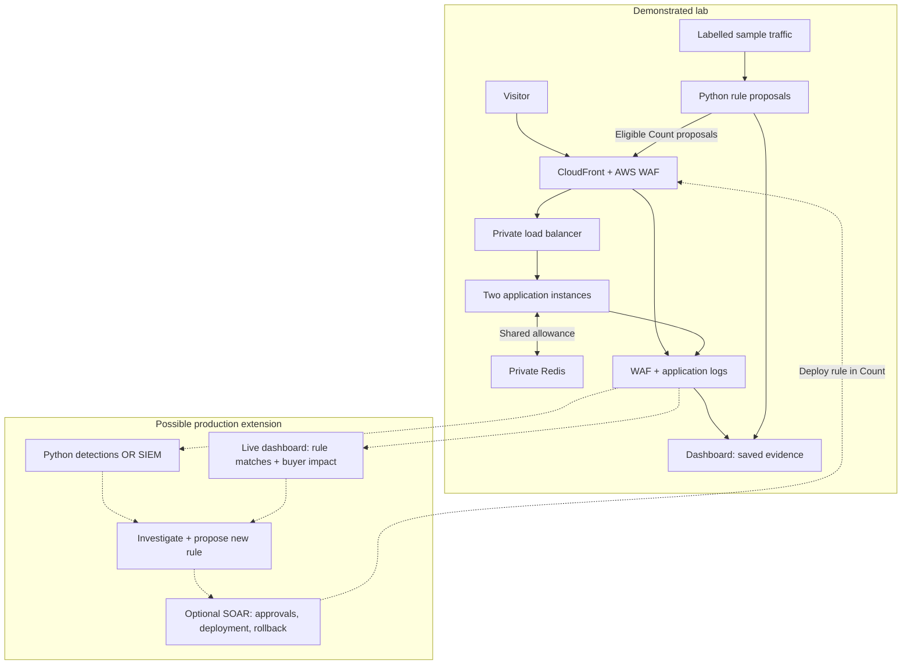

# Marketplace Traffic Defence Lab

I built this demo to test endpoint traffic controls and review buyer impact before enforcement.

[Open dashboard](https://kenydebo.github.io/marketplace-traffic-defence-lab/) · [AWS validation](https://github.com/kenydebo/marketplace-traffic-defence-lab/actions/runs/38456472401)

**Solid arrows:** demonstrated lab. **Dashed arrows:** possible extensions. Demo recommendations use labelled sample traffic; its dashboard displays saved results.

**Verified 13 October 2026:** 18 AWS checks, 12 local integration checks and six recommendation tests passed. AWS resources were removed and cleanup verified.

[Setup and design](docs/IMPLEMENTATION.md) · [Walkthrough](docs/DEMO.md) · [Runbook](docs/RUNBOOK.md)
