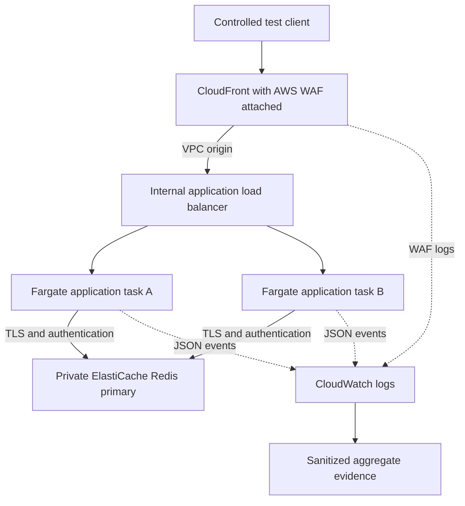

# Marketplace Traffic Defence Lab

An evidence-driven portfolio lab for marketplace bot and traffic defence. A synthetic buyer API runs behind layered controls; an explainable Python script turns trusted baseline traffic into endpoint proposals, tests buyer impact, and withholds unsafe recommendations.

**Dashboard:** https://kenydebo.github.io/marketplace-traffic-defence-lab/

This is independent portfolio work. It is not a Faire deployment, uses no Faire/customer data, and does not claim production detection accuracy or conversion impact.

## What the application does

Buyers browse a sample catalog, view product IDs, search with bounded query cost, obtain signed anonymous sessions, authenticate a fixture account, and submit a simulated cart item. There is no inventory database, persistent cart or payment flow.

Two application instances share Redis token buckets. Redis is temporary shared rate-limit memory: adding instances does not give one signed session a fresh allowance per instance. A short Lua script atomically refills and consumes tokens on one Redis primary. Login/session use source-address keys; browsing uses a verified session when available. All product IDs share a route allowance.

The local Redis-outage experiment allows only a small **per-instance** browsing fallback and rejects login/cart/session while shared state is unavailable. The fallback is explicitly not a global quota.

## Recommendation flow

1. Generate **labelled synthetic** buyer, shared-network, burst-abuse and slow-abuse journeys.
2. Use only the trusted calibration window to calculate P99 cost per key/second and requests per source/minute.
3. Build a bounded candidate grid with explicit margins. The lab budgets are at most 64 burst tokens, six refill tokens/second, at most 1% legitimate request rejection, and at least 50% labelled-abuse rejection. These are declared demonstration constraints, not measured service capacity.
4. Replay application token buckets on a separate validation window and select an eligible candidate.
5. Evaluate the selected candidate on an additional holdout window. A failing holdout withholds the recommendation.
6. Generate eligible **WAF Count-mode** observations from the source-minute baseline. Real Count-mode results must be reviewed before any enforcement promotion.

The engine uses **Python's standard library**. No CrowdSec, ML, LLM, or opaque recommendation service is involved. The only application package is the Redis client. Descriptive enumeration, cost, failure and fingerprint-cohort measurements are supporting evidence; synthetic ground-truth labels never act as a runtime bot classifier.

The login candidate is deliberately retained for inspection but withheld when the separate shared-network holdout exceeds the buyer-impact budget. Below-threshold slow abuse remains visible as residual risk. JA4 values never independently cause a blocking recommendation.

Read [engineering decisions](docs/DECISIONS.md), [operating runbook](docs/RUNBOOK.md), [security boundaries](SECURITY.md), and [evidence guide](docs/EVIDENCE.md).

## AWS architecture



The WAF allows only the current test runner's IPv4 /32. It blocks a synthetic marker, deploys eligible endpoint recommendations in Count, and observes JA4 aggregation on the product route. A **separate** synthetic catalog probe temporarily moves to Block during verification, then returns to Count. That probe is not represented as a production-calibrated recommendation.

The internal ALB and Redis have no public ingress. Tasks have public addresses for image-pull/logging egress but accept application traffic only from the ALB security group. This avoids a persistent NAT gateway in the disposable lab. CloudFront-to-ALB and ALB-to-app use private HTTP; viewer traffic and Redis use TLS. This is not an end-to-end TLS claim. One Redis primary is a cost-bounded demonstration, not HA or a durable multi-region quota.

## Run it

Requires Docker Compose and Python 3.9+ locally. CI/application images use Python 3.12.

```sh
python3 scripts/local_env.py
docker compose up -d --build
python3 tests/integration.py --outage
python3 traffic/generate.py
python3 analysis/recommend.py
python3 tests/recommendation_test.py
python3 infra/generate.py
python3 -m http.server 18100 --bind 127.0.0.1 --directory site
```

Open http://127.0.0.1:18100. API instances listen only on localhost ports 18081/18082. Stop the local server with Ctrl-C and containers with `docker compose down --volumes`.

## Deploy a fresh disposable AWS lab from GitHub

In **Settings → Secrets and variables → Actions**, configure:

| Kind | Name | Value |
|---|---|---|
| Secret | `AWS_ACCESS_KEY_ID` | Current disposable lab key |
| Secret | `AWS_SECRET_ACCESS_KEY` | Current lab secret |
| Secret | `AWS_SESSION_TOKEN` | Required for session credentials; omit for non-session credentials |
| Variable | `AWS_REGION` | `us-east-1` |
| Variable | `AWS_EXPECTED_ACCOUNT_ID` | The explicitly authorized lab account ID |

Then **Actions → Disposable AWS lab → Run workflow** on `main`. The workflow verifies account identity, creates two isolated CloudFormation stacks, pushes a digest-pinned image, deploys, tests, collects sanitized evidence, and deletes its stacks. Application secrets are generated in AWS Secrets Manager and do not belong in GitHub variables.

Updating credentials permits a new run; **CloudFormation recreates the environment**. Credentials alone do not recreate resources. Pluralsight accounts may deny required services. Permission failures are reported without claiming a successful deployment. The public dashboard survives lab expiry.

AWS operations never run on push or a pull request. GitHub Actions are pinned to commit SHAs. Failed steps still attempt cleanup, but hard cancellation, expired credentials, provider failures or runner loss can interrupt it. Use the recovery instructions in the runbook. The AWS workflow uploads only sanitized evidence; it does not auto-commit artifacts to `main` or overwrite the public dashboard.

For an AWS account you own, replace copied credentials with a narrowly scoped GitHub OIDC role. Temporary lab credentials can expire or prevent IAM/OIDC setup.

## Evidence

- [Local integration](site/data/integration.json): actual two-instance Redis checks, including outage behaviour.
- [Recommendations](site/data/recommendations.json): labelled synthetic replay; includes dataset SHA-256, candidates, holdout and limitations.
- [AWS evidence](site/data/aws.json): full-stack attempt/live results and cleanup status, when collected. Read its `evidence_type` and individual checks before making claims.
- [Source dataset](traffic/scenarios.jsonl): generated synthetic events, not captured buyer data.

Deployment code is not proof of deployment. Synthetic false-positive/abuse rates are not production precision, recall, or business outcomes.

## References

- [AWS CloudFront VPC origins](https://docs.aws.amazon.com/AmazonCloudFront/latest/DeveloperGuide/private-content-vpc-origins.html)
- [AWS WAF logging](https://docs.aws.amazon.com/waf/latest/developerguide/logging.html)
- [AWS JA3/JA4 support](https://aws.amazon.com/about-aws/whats-new/2025/03/aws-waf-ja4-fingerprinting-aggregation-ja3-ja4-fingerprints-rate-based-rules/)
- [Redis atomic Lua execution](https://redis.io/docs/latest/develop/programmability/eval-intro/)

MIT licensed. See [LICENSE](LICENSE).
